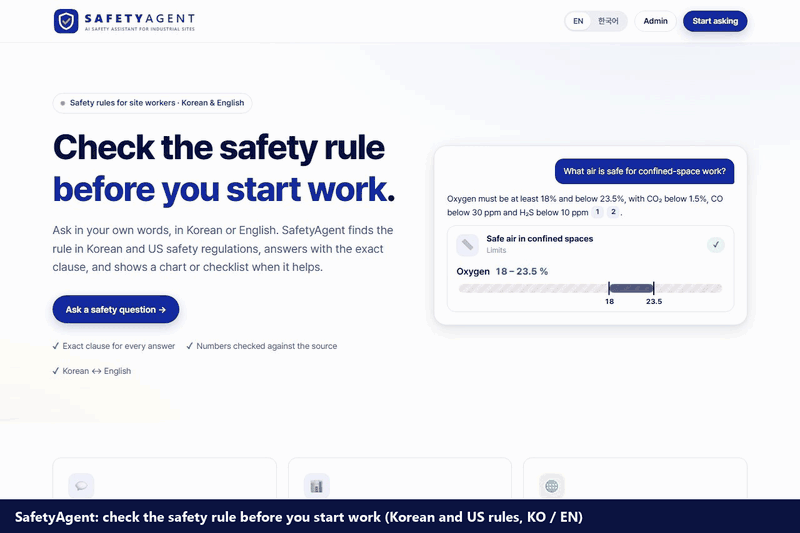
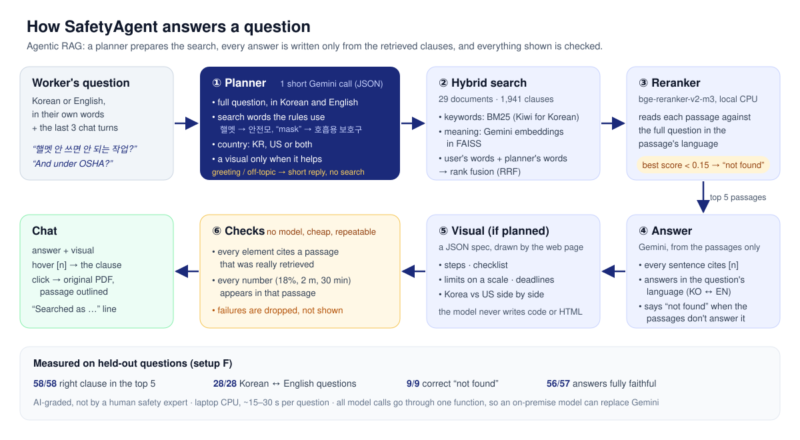
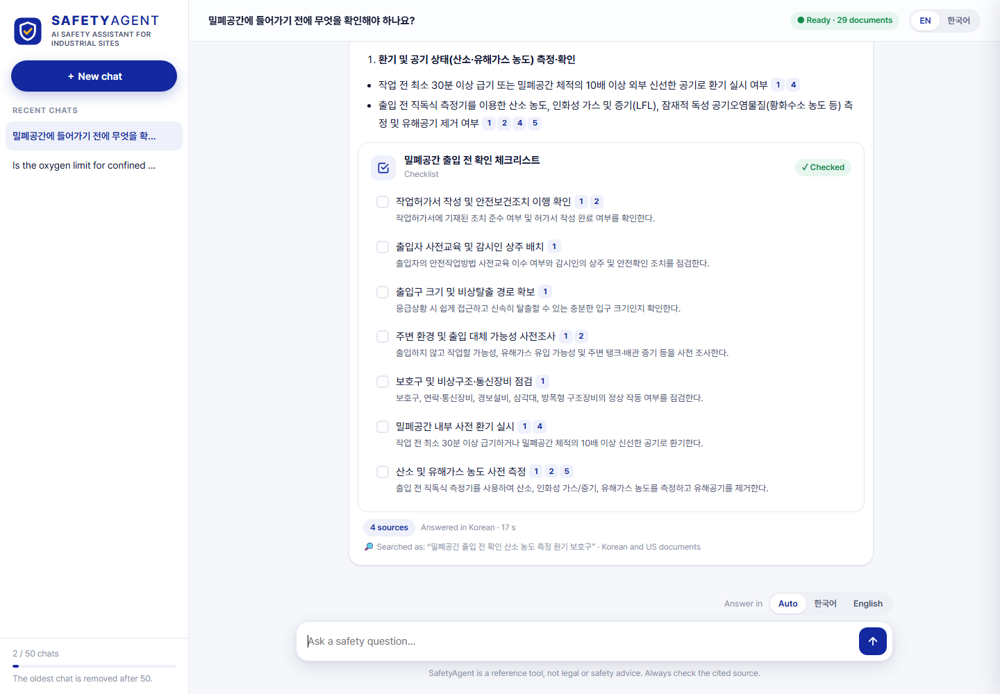

# SafetyAgent

**Check the safety rule before you start work.**

SafetyAgent answers workplace-safety questions for construction and plant sites from **Korean and US safety rules**
(the Korean Occupational Safety and Health Act and its Standards Rule, KOSHA guides, OSHA standards), in Korean or
English. Workers ask in their own words; there are no modes to choose. It is an **agentic RAG** system: a planner
understands the request (including follow-ups), rewrites it into the words the regulations use, decides which
country's documents to search and whether a visual helps, then answers:

- 💬 **a cited answer**: every statement links to the exact clause (hover to read it, click to open the PDF with the
  passage outlined), or an honest *"not found"* when the documents don't cover it;
- 📊 **a visual when it helps**: procedures as step flows, requirements as checklists, limits on a scale, deadlines
  on a timeline, and **Korea vs US** side by side in one table.

Nothing is shown unless it is checked: every visual element must cite a passage, and every number must appear in
that passage. The code package is named `plant_rag` (the project started as a process-safety RAG).

**Demo (80 s):** a Korean question answered with a checklist → hover and click a citation → a follow-up limited to
OSHA → Korea vs US in one table. Waiting time is sped up. [Watch the MP4 with full resolution](docs/demo/safetyagent_demo.mp4).



**How it works**



## Results

Measured on held-out questions that were never used to tune the system. Setup **F** is what users get (the planner
rewrites the question for search, see [How it works](#how-it-works)); E is the same search without the planner.

**Search and answers**

| Test set | Questions | Right clause in top 5 (Recall@5) | Cross-language | MRR@10 | "Not found" correct / wrong | Answers faithful / fully correct |
|---|---|---|---|---|---|---|
| Set 1 · process safety · 10 docs (first version, E) | 40 | 34/34 | 16/16 | 0.92 | 6/6 · 1/34 | 33/33 · 32/33 |
| Set 1 · same questions · 29 docs · E | 40 | 34/34 | 16/16 | 0.92 | 6/6 · 1/34 | not re-graded |
| Set 1 · 29 docs · **F (final)** | 40 | **34/34** | **16/16** | **0.98** | **6/6 · 1/34** | **33/33 · 33/33** |
| Set 2 · **new topics** (confined spaces, lockout, forklifts, falls, welding, PPE, heat, risk assessment, OSH Act) · E | 27 | 23/24 | 11/12 | 0.94 | 3/3 · 1/24 | 23/23 · 22/23 |
| Set 2 · **F (final)** | 27 | **24/24** | **12/12** | **0.93** | **3/3 · 0/24** | **23/24 · 24/24** |

- Tripling the corpus (10 → 29 documents) did not hurt the first test set, and the new topics work as well.
- The planner (F) finds the one clause E missed (the harness-height article 제32조) and removes the wrong "not found"
  on set 2; on set 1 it moves right clauses up to rank 1 (MRR 0.92 → 0.98).
- The one wrong "not found" left (set 1, q030, a HAZOP node question) is the model's own refusal, the same as E.
- The one partly faithful answer (set 2, q084) translated "화물이 적거나" as "poorly secured loads"; every other
  sentence of the 57 graded answers is supported by the passage it cites.

**How F was measured (honest note).** The first F run ([`test_v3`](eval/results/test_v3),
[`test2_v2`](eval/results/test2_v2)) gave set 2: 23/24, cross-language 11/12, MRR 0.86, one wrong "not found".
Looking at it showed two flaws in the new search code: with three query versions only one passage per search list
reached the reranker, and Korean passages were reranked against the planner's keyword list instead of a full
question. Both were fixed (≥ 2 per list; the planner also writes the full question in the other language; no
English keyword search in Korean-only documents and the reverse). Then job plans and notices were removed, which
changed the planner prompt. The final rows ([`test_v5`](eval/results/test_v5), [`test2_v4`](eval/results/test2_v4))
are the shipped code, **measured again on the same test questions, so they are slightly optimistic**; the dev set
([`dev_v5`](eval/results/dev_v5)) shows no regression (16/16, 7/7, 0 wrong "not found").

Search setups compared on set 2 (A = keyword only … F = the agent's search):


| Setup (set 2, 29 docs) | Recall@5 | Cross-language | Wrong "not found" |
|---|---|---|---|
| A · BM25 keyword | 14/24 | 2/12 | – |
| B · Dense (meaning) | 23/24 | 11/12 | – |
| C · Hybrid (RRF) | 16/24 | 4/12 | 8/24 |
| D · Hybrid + reranker | 22/24 | 10/12 | 1/24 |
| E · D + query translation | 23/24 | 11/12 | 1/24 |
| **F · D + planner queries (KO + EN, documents' words) + country filter** | **24/24** | **12/12** | **0/24** |

**Agent** ([`eval/results/agent_v4`](eval/results/agent_v4))

| Check | Result |
|---|---|
| Planner picks the right path (answer or chitchat), 52 requests in KO + EN, incl. 6 harder mixed ones and 10 follow-up / everyday-word cases | **52/52** |
| … adds the requested visual type (16 cases) · picks the right country (13) · searches with the documents' words (9: "숨 쉬는 마스크" → 호흡용 보호구, "밟고 서는 판" → 작업발판) | **16/16 · 13/13 · 9/9** |
| Job questions ("tomorrow we weld inside a tank…") and poster requests: answered with a checklist | 16/17 checklist, 1 limits |
| Plain questions that got a visual without asking (the rest are single facts) | 6/12 |
| Visuals produced, of the requested type | **11/12** (the 12th, Korea vs US fall-protection height: "not found", score below the threshold) |
| Visual elements kept by the checks (citation + numbers guard) | 55/58 (3 removed: number not in the cited passage) |
| Shown elements contradicting their cited passage (223 reviewed in an earlier agent run, `agent_v2`) | **0 found** |

Median time per visual answer on a laptop CPU: ~31 s.

**What we learned**
- **Cross-language questions decide the ranking.** Keyword search finds nothing across languages, and the reranker
  scores Korean–English pairs too low. Searching in both languages fixes both.
- **Rewrite the request, but keep the user's words too.** The planner fixes vocabulary (핼멧 → 안전모, "a mask to
  breathe" → 호흡용 보호구) and drops request words ("make a poster"), but its keyword lists are a poor input for
  the reranker. Searching the original question plus the planner's queries, and reranking against full questions,
  works best.
- **The model rarely invents.** Errors are a missed clause or a too-strict "not found", almost never a made-up fact.
- **Checks catch what review misses.** The numbers guard drops a visual element whose number is not in its source.
- **Simple beats feature-rich for site workers.** Job plans and printable notices worked in evaluation (6/6 each,
  [`agent_v3`](eval/results/agent_v3)) but made the app harder to understand; they were removed so that a worker just
  asks and gets one clear answer.
- **Trade-off:** ~15–30 s per question on a laptop CPU, mostly the reranker.

Details: [`eval/results/`](eval/results/) (per-question rows, summaries, grades) and
[`notebooks/02_eval_analysis.ipynb`](notebooks/02_eval_analysis.ipynb) (first version).

## How it works

The diagram at the top shows the flow. Step by step:

1. **Ingest and chunk** 29 public PDFs by clause: law articles (제N조), KOSHA sections, CFR paragraphs and
   appendices. Korean KOSHA PDFs have no space characters (rebuilt from character gaps); running headers, page
   numbers, tables of contents and margin stamps are removed. 1,941 chunks.
2. **Index**: Gemini embeddings (`gemini-embedding-001`) in FAISS + BM25 with Korean morphemes (Kiwi). All API
   results are cached on disk.
3. **Plan** (`agent.py`, one short structured call): the planner reads the message and the last chat turns and
   returns the follow-up rewritten as a full question (in both languages), one search query in Korean and one in
   English **in the documents' words**, the country (KR, US or both), and a visual type only when it helps
   (steps, checklist, limits, intervals, Korea-vs-US table). The user never picks a mode.
4. **Search** (setup F): the user's question and the planner's two queries go through keyword and meaning search;
   rank fusion; a multilingual reranker (bge-reranker-v2-m3, CPU) reads each passage against the full question in
   the passage's language. "Only Korean rules" searches only the Korean documents. Below a tuned score it answers
   "not found" without calling the model. The chat shows what was searched ("Searched as …").
5. **Answer and visual** (`generate.py`, `visuals.py`): the model writes only from the numbered passages and cites
   each statement. A visual is a **JSON spec** that the web page draws; the model never writes code or HTML.
6. **Checks** (`checks.py`): citation check + numbers guard on every visual element; failures are dropped.

All model calls go through one function (`generate.call_llm_record`), so an on-premise model can replace Gemini.
Plain-English notes on every step: [`docs/how_it_works.md`](docs/how_it_works.md).

## The web app

| Page | What it does |
|---|---|
| **Chat** (`/chat`) | Ask in KO/EN in your own words; the agent adds a chart or checklist when it helps; "Searched as …" line; live progress of each agent step; citations: **hover** for the passage, **click** for the original PDF with the passage outlined; answer language Auto / 한국어 / English; 50 chats per browser. |
| **Admin** (`/admin`, password) | Review answers against all passages the model saw, with the planner's decision (visual, country, search queries); test console with any search setup; documents; settings. |
| **Landing** (`/`) | One short page for site workers: what it does, measured results, start asking. EN / 한국어 interface. |




## Data (29 public documents)

| Documents | Language | Source |
|---|---|---|
| 산업안전보건법 (Occupational Safety and Health Act) | KO | law.go.kr |
| 산업안전보건기준에 관한 규칙 (Safety and Health Standards Rule, full text) | KO | law.go.kr |
| 사업장 위험성평가에 관한 지침 (risk assessment guideline, 고용노동부고시) | KO | law.go.kr |
| 16 KOSHA guides: confined spaces, lockout/tagout, forklifts, vehicles in workplaces, safety nets, welding fire prevention, PPE, hot environments, job risk assessment, work permits, relief valves, HAZOP, management of change, pre-startup review, inspection & maintenance, atmospheric tanks | KO | KOSHA portal |
| 9 OSHA standards (2025 CFR): 1910.119 PSM, 1910.132 PPE, 1910.135 head protection, 1910.146 confined spaces, 1910.147 lockout/tagout, 1910.178 forklifts, 1910.252 welding, 1926.501–.502 fall protection | EN | govinfo.gov |
| OSHA 3132 *Process Safety Management* booklet | EN | osha.gov |

PDFs and chunks are **not** in this repository; [`data/manifest.csv`](data/manifest.csv) lists every source URL.
Only public documents are sent to the Gemini API.

## Evaluation method

- **Retrieval and answers**: 87 bilingual questions (`eval/questions.jsonl`). Set 1 (60, on process safety): 20
  dev (used for design choices) / 40 test. Set 2 (27, on the new topics: confined spaces, lockout, forklifts,
  falls, welding, PPE, heat, risk assessment, the OSH Act): all held out. Gold labels list **every** chunk that
  states the answer. Metrics: Recall@5, MRR@10, refusals, citations; answers graded with
  [`eval/faithfulness_rubric.md`](eval/faithfulness_rubric.md).
- **Agent** (`python -m plant_rag.eval_agent`): planner accuracy on 52 labeled requests (42 single requests incl.
  6 harder mixed ones, + 10 follow-up / everyday-word cases), and 12 visual requests end to end with the automatic
  checks.
- **Honest caveats**: questions, gold labels and grades were written and verified by AI (Claude), **not by a human
  safety expert**. The sets are small (one question ≈ 3–4 percentage points), and the final F rows were measured on
  test questions that had already been looked at once (see the honest note above).

## Limitations

- Laptop CPU: ~15–60 s per request (reranker); a GPU makes reranking near-instant.
- Tables are flattened into text; some KOSHA equations can't be decoded (`[수식]`). Page numbers are PDF pages.
- The planner sometimes puts what it already knows into its search queries: a standard number (API 650,
  1910.119) or even the expected value ("… 48 hours"), although the prompt asks it not to. This only changes the
  ranking (answers come from the passages, numbers are checked), but a wrong guess could push the right clause down.
- One Korea-vs-US comparison (fall-protection height) still ends in "not found": the Korean clause scores below the
  threshold for that combined question.
- **This is a reference tool, not legal or safety advice.** It does not replace a supervisor, a safety professional
  or the site's safety procedures.

## Run it

Requirements: Python 3.11+ (tested on 3.13, Windows), ~3 GB disk for the reranker model, a Gemini API key.

```powershell
python -m venv "$env:USERPROFILE\envs\plant-rag"     # keep the environment outside synced folders (OneDrive)
& "$env:USERPROFILE\envs\plant-rag\Scripts\Activate.ps1"
pip install torch --index-url https://download.pytorch.org/whl/cpu
pip install -r requirements.txt
pip install -e .
```

**Gemini API key**: create one in [Google AI Studio](https://aistudio.google.com/). Set `GEMINI_API_KEY`, or save
the key to `secrets/gemini_api_key.txt` (git-ignored; never commit it).

```powershell
python -m plant_rag.smoke_test      # one answer + one embedding call (< US$0.01)
python -m plant_rag.ingest          # PDFs in data/raw/ -> page lines
python -m plant_rag.chunk           # -> clause chunks
python -m plant_rag.index           # -> embeddings + indexes (~US$0.10 the first time)
python -m plant_rag.ask "밀폐공간 작업 시 적정공기 기준은?"
```

Web app (http://127.0.0.1:8000, localhost only):

```powershell
python -m app.auth --username admin    # once: set the admin password (only a hash is stored, in secrets/)
python -m app.server
```

Evaluate:

```powershell
python -m plant_rag.evaluate --split test2 --setups A,B,C,D,E,F --run my_run
python -m plant_rag.eval_agent --part all --run my_agent_run
```

All settings (models, search sizes, thresholds, chat limits) are in
[`configs/config.yaml`](configs/config.yaml).

## Project structure

```
configs/config.yaml        all settings
src/plant_rag/
  ingest.py  chunk.py      PDF -> page lines -> clause chunks
  embed.py   index.py      Gemini embeddings (cached) -> FAISS + BM25
  retrieve.py              BM25 + dense -> RRF -> reranker (setups A-F, country filter)
  generate.py              prompts, answers, citations, refusal, the one LLM function
  agent.py                 planner -> search -> answer -> visual
  visuals.py  checks.py    structured visuals; citation check + numbers guard
  ask.py evaluate.py eval_agent.py   CLI demo, retrieval/answer evaluation, agent evaluation
app/                       web app (FastAPI): server.py, engine.py, store.py (SQLite), auth.py
  static/                  landing, chat, admin (HTML/CSS/JS)
eval/                      questions, agent cases, rubric, results
docs/                      how_it_works.md, figures, brand (logo)
```

## License

MIT for the code and documentation ([`LICENSE`](LICENSE)). The safety documents are public documents from their
publishers and are not included in this repository.
