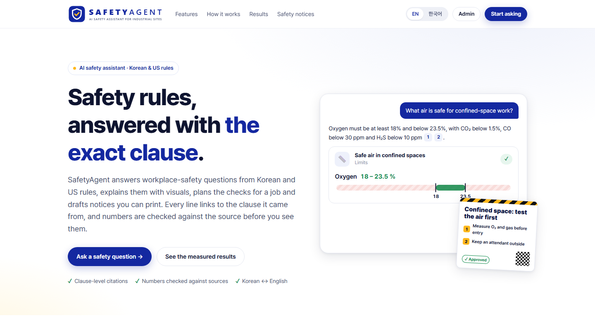
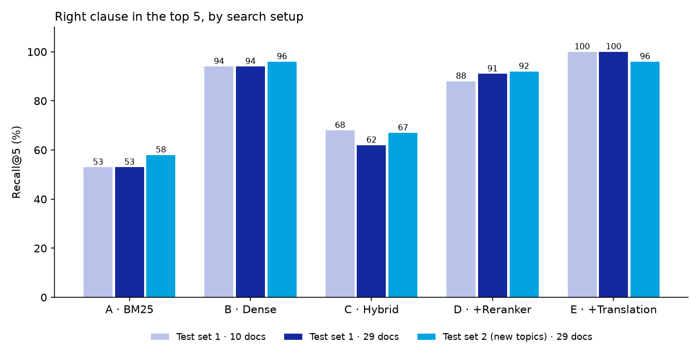
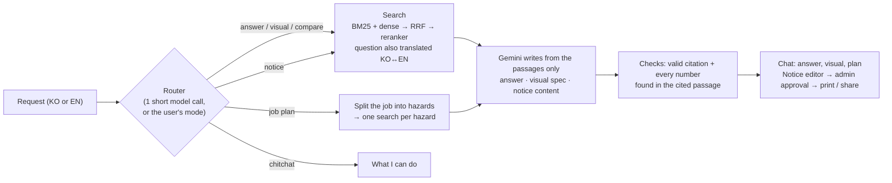
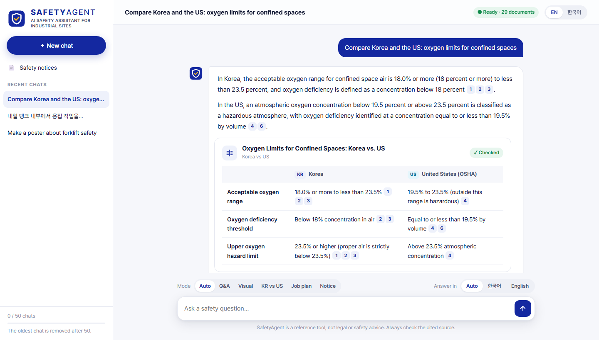
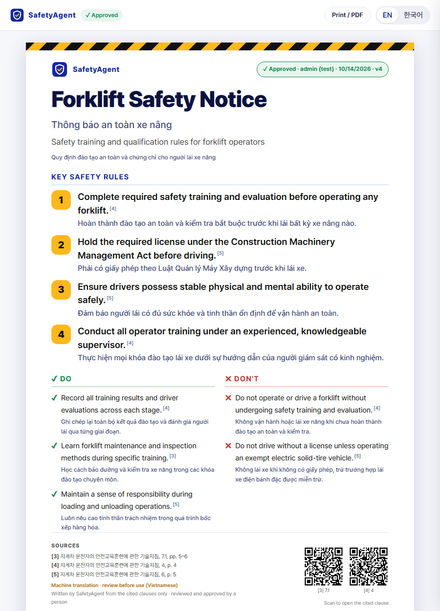

# SafetyAgent

**AI safety assistant for industrial sites.**

SafetyAgent answers workplace-safety questions from **Korean and US safety rules** (KOSHA guides, the Korean
Occupational Safety and Health Act and its rules, OSHA standards), in Korean or English. It is an **agent**: it
decides what a request needs and uses the right tool:

- 💬 **answers** with the exact clause cited for every statement, or an honest *"not found"*;
- 📊 **visuals**: procedures as step flows, requirements as checklists, limits on a scale, deadlines on a timeline;
- ⚖️ **Korea vs US** comparisons in one table;
- 🧰 **job plans**: describe tomorrow's work, get permits, hazards, controls, checks, PPE and a TBM briefing;
- 📄 **notices** to print or share: poster, leaflet, messenger card or TBM sheet, with QR codes to the clauses
  and a second language for foreign workers, **approved by a person** before posting.

Nothing is shown unless it is checked: every line must cite a passage, and every number must appear in that
passage. The code package is named `plant_rag` (the project started as a process-safety RAG).



## Results

Measured on held-out questions that were never used to tune the system (setup E = the one users get).

**Search and answers**

| Test set | Questions | Right clause in top 5 (Recall@5) | Cross-language | MRR@10 | "Not found" correct / wrong | Answers faithful / fully correct |
|---|---|---|---|---|---|---|
| Set 1 · process safety · 10 docs (first version) | 40 | 34/34 | 16/16 | 0.92 | 6/6 · 1/34 | 33/33 · 32/33 |
| Set 1 · same questions · **29 docs** | 40 | **34/34** | **16/16** | **0.92** | **6/6 · 1/34** | not re-graded |
| Set 2 · **new topics** (confined spaces, lockout, forklifts, falls, welding, PPE, heat, risk assessment, OSH Act) · 29 docs | 27 | **23/24** | **11/12** | **0.94** | **3/3 · 1/24** | **23/23 · 22/23** |

Tripling the corpus did not hurt the first test set, and the new topics work almost as well. Search setups
compared on all three runs (A = keyword only … E = hybrid + reranker + translating the question):



| Setup (set 2, 29 docs) | Recall@5 | Cross-language | Wrong "not found" |
|---|---|---|---|
| A · BM25 keyword | 14/24 | 2/12 | – |
| B · Dense (meaning) | 23/24 | 11/12 | – |
| C · Hybrid (RRF) | 16/24 | 4/12 | 8/24 |
| D · Hybrid + reranker | 22/24 | 10/12 | 1/24 |
| **E · D + query translation** | **23/24** | **11/12** | **1/24** |

**Agent**

| Check | Result |
|---|---|
| Router picks the right tool (answer / visual / compare / job plan / notice / chitchat), 42 requests in KO + EN, incl. 6 harder mixed ones | **42/42** |
| Visuals produced, of the requested type | **11/12** (the 12th: "not found", score below the threshold) |
| Visual elements kept by the checks (citation + numbers guard) | 54/59 (5 removed: number not in the cited passage, or no valid citation) |
| Job plans produced · expected hazards covered · plan items kept | **6/6 · 7/7 · 114/114** |
| Notices produced · lines kept | **6/6 · 66/66** |
| Translated notice lines whose numbers survive translation + back-translation (vi, en, th, ko, uz) | 75/78 (the 3 flags: "half hour" → "30분", a date format; meaning kept, sent to the reviewer) |
| Shown elements contradicting their cited passage (223 reviewed) | **0 found** |

Review notes and the problems found (two check bugs, fixed: step numbers and "[n]" marks were checked as
numbers; open: a missed two-part question, a retrieval miss in one comparison, repeated lines in two notices):
[`eval/results/agent_v1/review.md`](eval/results/agent_v1/review.md). Timing on a laptop CPU: visual ~37 s, notice
~29 s, job plan ~66 s (three searches).

**What we learned**
- **Cross-language questions decide the ranking.** Keyword search finds nothing across languages; the reranker
  scores Korean–English pairs too low. Translating the question (one small cached call) fixes both.
- **The model rarely invents.** Every graded answer was faithful to its passages; the errors are a missed
  clause (set 2: the harness-height article 제32조 was not retrieved) and a too-strict refusal (a forklift
  question whose right clause ranked #1 but scored 0.07, below the "not found" threshold of 0.15).
- **Checks catch what review misses.** The numbers guard flags an edited notice line ("999 kg") immediately, and
  back-translation shows whether a Vietnamese line still says what the Korean one says.
- **Bug found by the new test set:** English questions containing a Korean term ("… safety net (추락방호망)?") were
  answered in Korean, because language detection looked for any Hangul. Fixed after the run (Hangul must carry
  the question); all 87 questions are now detected correctly.
- **Trade-off:** setup E takes ~15–30 s per question on a laptop CPU, mostly the reranker.

Details: [`eval/results/`](eval/results/) (per-question rows, summaries, grades) and
[`notebooks/02_eval_analysis.ipynb`](notebooks/02_eval_analysis.ipynb) (first version).

## How it works



1. **Ingest and chunk** 29 public PDFs by clause: law articles (제N조), KOSHA sections, CFR paragraphs and
   appendices. Korean KOSHA PDFs have no space characters (rebuilt from character gaps); running headers, page
   numbers, tables of contents and margin stamps are removed. 1,941 chunks.
2. **Index**: Gemini embeddings (`gemini-embedding-001`) in FAISS + BM25 with Korean morphemes (Kiwi). All API
   results are cached on disk.
3. **Search** (setup E): the question is also translated into the other language; keyword and meaning search run
   for both; rank fusion; a multilingual reranker (bge-reranker-v2-m3, CPU) reads each passage against the
   question in the passage's language. Below a tuned score it answers "not found" without calling the model.
4. **Agent tools** (`agent.py`): answers (`generate.py`), visuals (`visuals.py`), job plans, notices
   (`notices.py`). The model fills **JSON specs** that the web page draws; it never writes code or HTML.
5. **Checks** (`checks.py`): citation check + numbers guard on everything shown, printed or posted; the notice
   editor re-checks human edits; translations are checked by back-translation.

All model calls go through one function (`generate.call_llm_record`), so an on-premise model can replace Gemini.
Plain-English notes on every step: [`docs/how_it_works.md`](docs/how_it_works.md).

## The web app

| Page | What it does |
|---|---|
| **Chat** (`/chat`) | Ask in KO/EN; mode switch (Auto · Q&A · Visual · KR vs US · Job plan · Notice); live progress of each agent step; citations: **hover** for the passage, **click** for the original PDF with the passage outlined; "Show as a visual", "Make a notice", "Make a TBM sheet" buttons; 50 chats per browser. |
| **Notices** (`/notices`) | Draft from a topic or a chat answer; edit the text in place (numbers re-checked); 4 print templates; second language (16 languages offered) with back-translation; print / PDF, PNG image, share link + QR after approval. |
| **Admin** (`/admin`, password) | Review answers against all passages the model saw; **approve notices**; test console with any search setup and agent mode; documents; settings. |
| **Landing** (`/`) | What SafetyAgent does, built vs planned modules, measured results. EN / 한국어 interface. |





## Data (29 public documents)

| Documents | Language | Source |
|---|---|---|
| 산업안전보건법 (Occupational Safety and Health Act) | KO | law.go.kr |
| 산업안전보건기준에 관한 규칙 (Safety and Health Standards Rule, full text) | KO | law.go.kr |
| 사업장 위험성평가에 관한 지침 (risk assessment guideline, 고용노동부고시) | KO | law.go.kr |
| 16 KOSHA guides: confined spaces, lockout/tagout, forklifts, vehicles in workplaces, safety nets, welding fire prevention, PPE, hot environments, job risk assessment, work permits, relief valves, HAZOP, management of change, pre-startup review, inspection & maintenance, atmospheric tanks | KO | KOSHA portal |
| 9 OSHA standards (2025 CFR): 1910.119 PSM, 1910.132 PPE, 1910.135 head protection, 1910.146 confined spaces, 1910.147 lockout/tagout, 1910.178 forklifts, 1910.252 welding, 1926.501–.502 fall protection | EN | govinfo.gov |
| OSHA 3132 *Process Safety Management* booklet | EN | osha.gov |

PDFs and chunks are **not** in this repository; [`data/manifest.csv`](data/manifest.csv) lists every source URL.
Only public documents are sent to the Gemini API.

## Evaluation method

- **Retrieval and answers**: 87 bilingual questions (`eval/questions.jsonl`). Set 1 (60, on process safety): 20
  dev (used for design choices) / 40 test. Set 2 (27, on the new topics: confined spaces, lockout, forklifts,
  falls, welding, PPE, heat, risk assessment, the OSH Act): all held out. Gold labels list **every** chunk that
  states the answer. Metrics: Recall@5, MRR@10, refusals, citations; answers graded with
  [`eval/faithfulness_rubric.md`](eval/faithfulness_rubric.md).
- **Agent** (`python -m plant_rag.eval_agent`): router accuracy on 42 labeled requests (6 per intent + 6 harder,
  mixed ones); 12 visuals, 6 job plans and 6 notices end to end, with the automatic checks and a faithfulness
  grade per element.
- **Honest caveats**: questions, gold labels and grades were written and verified by AI (Claude), **not by a human
  safety expert**. The sets are small (one question ≈ 3–4 percentage points).

## Limitations

- Laptop CPU: ~20–60 s per request (reranker); a GPU makes reranking near-instant.
- Tables are flattened into text; some KOSHA equations can't be decoded (`[수식]`). Page numbers are PDF pages.
- Machine translation of notices is checked for numbers, not certified; it is labelled "review before use".
- Planned, not built: camera watch (PPE / danger-zone alerts linked to rules), site photo review, danger
  anticipation from video. **This is a reference tool, not legal or safety advice.**

## Run it

Requirements: Python 3.11+ (tested on 3.13, Windows), ~3 GB disk for the reranker model, a Gemini API key.

```powershell
python -m venv "$env:USERPROFILE\envs\plant-rag"     # keep the environment outside synced folders (OneDrive)
& "$env:USERPROFILE\envs\plant-rag\Scripts\Activate.ps1"
pip install torch --index-url https://download.pytorch.org/whl/cpu
pip install -r requirements.txt
pip install -e .
```

**Gemini API key**: create one in [Google AI Studio](https://aistudio.google.com/). Set `GEMINI_API_KEY`, or save
the key to `secrets/gemini_api_key.txt` (git-ignored; never commit it).

```powershell
python -m plant_rag.smoke_test      # one answer + one embedding call (< US$0.01)
python -m plant_rag.ingest          # PDFs in data/raw/ -> page lines
python -m plant_rag.chunk           # -> clause chunks
python -m plant_rag.index           # -> embeddings + indexes (~US$0.10 the first time)
python -m plant_rag.ask "밀폐공간 작업 시 적정공기 기준은?"
```

Web app (http://127.0.0.1:8000, localhost only):

```powershell
python -m app.auth --username admin    # once: set the admin password (only a hash is stored, in secrets/)
python -m app.server
```

Evaluate:

```powershell
python -m plant_rag.evaluate --split test2 --setups A,B,C,D,E --run my_run
python -m plant_rag.eval_agent --part all --run my_agent_run
```

All settings (models, search sizes, thresholds, agent limits, chat limits) are in
[`configs/config.yaml`](configs/config.yaml).

## Project structure

```
configs/config.yaml        all settings
src/plant_rag/
  ingest.py  chunk.py      PDF -> page lines -> clause chunks
  embed.py   index.py      Gemini embeddings (cached) -> FAISS + BM25
  retrieve.py              BM25 + dense -> RRF -> reranker (setups A-E)
  generate.py              prompts, answers, citations, refusal, translation, the one LLM function
  agent.py                 router + tools: answer, visual, compare, job plan, notice
  visuals.py  notices.py   structured visuals; notice content + translation check
  checks.py                citation check + numbers guard
  ask.py evaluate.py eval_agent.py   CLI demo, retrieval/answer evaluation, agent evaluation
app/                       web app (FastAPI): server.py, engine.py, store.py (SQLite), auth.py
  static/                  landing, chat, notices, notice view, admin (HTML/CSS/JS)
eval/                      questions, agent cases, rubric, results
docs/                      how_it_works.md, figures, brand (logo)
```
