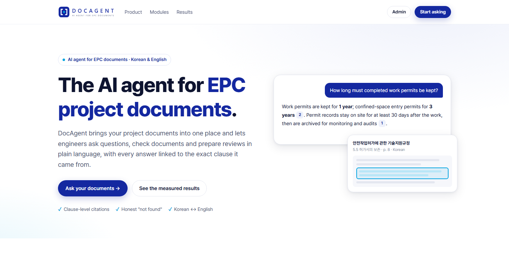
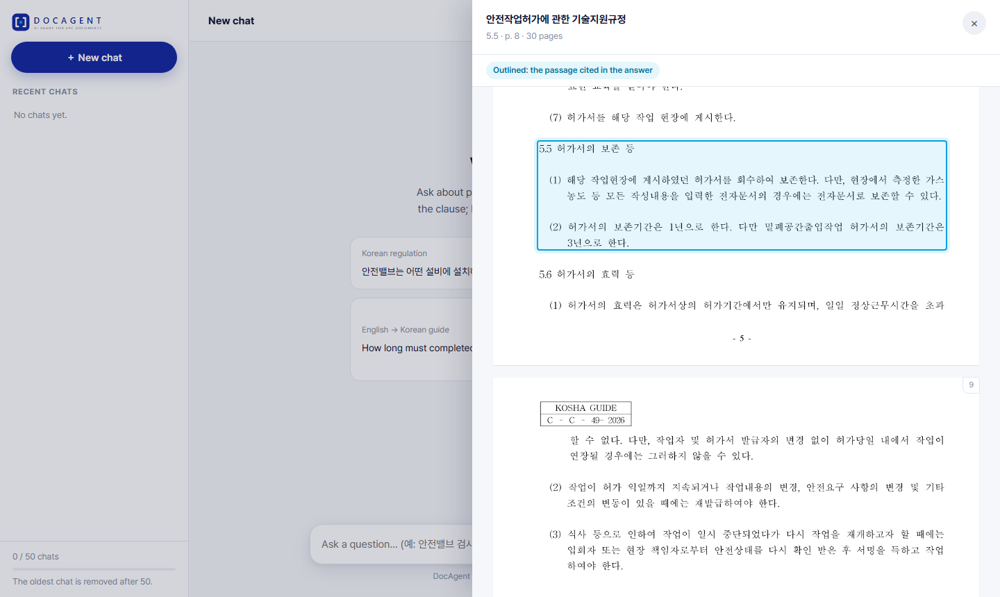
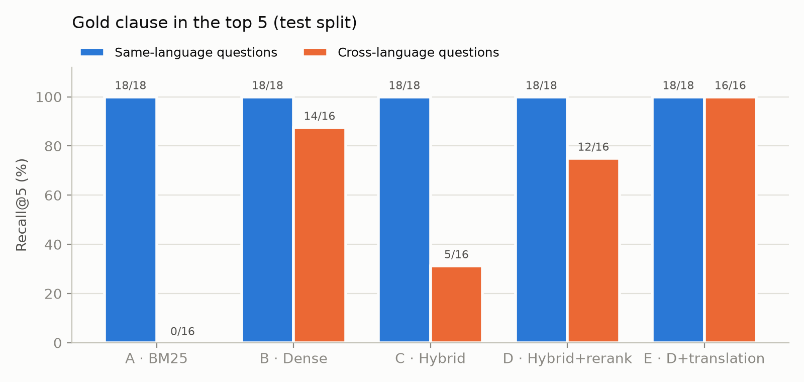
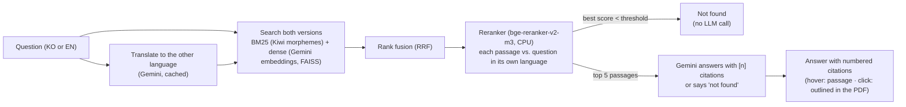

# DocAgent

**The AI agent for EPC project documents.**

DocAgent connects to the place where an EPC (engineering, procurement, construction) project keeps its
documents, its CDE (Common Data Environment) or document management system, and works on top of it.
Engineers ask questions in Korean or English and get answers that cite the exact clause. The agent also
takes multi-step tasks: checking a document against the specifications, comparing revisions, or drafting
review comments. It **prepares** the work and **a person approves it**. When the documents don't contain the
answer, it says so instead of guessing.

Main-page text and module descriptions for the platform: [`docs/docagent_main_page.md`](docs/docagent_main_page.md).

### Modules

| Module | What it does | Status |
|---|---|---|
| **DocAgent Ask** | Questions in KO / EN → answers with clause-level citations, or "not found" | ✅ Built and evaluated (this repository) |
| **DocAgent Search** | Find any document or clause across all sources and languages | ✅ Core built (hybrid search + reranker) |
| **DocAgent Library** | One register of all project documents, connected to SharePoint, Aconex, ProjectWise or shared folders | Planned |
| **DocAgent Check** | Check a datasheet or vendor document against specs and standards, and list mismatches with citations | Planned |
| **DocAgent Flow** | Track reviews, approvals and revisions; draft comment sheets for a person to approve | Planned |

### This repository: DocAgent Ask (first module)

A bilingual (Korean / English) assistant that answers questions about plant **process-safety standards**
with **clause-level citations**, and says *"not found"* when the documents do not contain the answer.
It is the "find and cite" tool that the agent's later steps are built on.

Engineers spend a lot of time finding the right clause across Korean regulations, KOSHA technical guides and
US OSHA rules, and a missed requirement is expensive. The code package is still named `plant_rag`.



## The platform

| | |
|---|---|
| **Chat** (`/chat`) | Chat-style Q&A for engineers. Answers show only the text with numbered citations: **hover** a number to read the exact passage, **click** to open the original PDF in a side panel with the passage outlined. New chats, history of up to 50 chats per browser, follow-up questions understood from context, live progress while the answer is prepared. |
| **Admin** (`/admin`, password) | Choose the search method users get (A–E, with measured results), review every user answer against its sources (correct / partly / incorrect + note), test console with any method, browse all documents and open the original PDFs. |
| **Landing** (`/`) | What DocAgent is, built vs planned modules, measured results. |



## What it does

- **Ask in Korean or English**; the answer comes back in the question's language.
- **Cross-language search**: a Korean question can be answered from the US CFR, an English question from a
  Korean KOSHA guide or law article.
- **Every claim cites a passage** `[n]` → document, clause and page (e.g. *산업안전보건기준에 관한 규칙,
  제261조 ①–②, p. 46*).
- **Refuses instead of guessing** when the documents do not cover the question.
- **Measured**: a 60-question bilingual test set, five search setups compared (ablation), answers graded for
  faithfulness and correctness.

## Results

On **40 held-out test questions** (34 answerable, 16 of them cross-language; 6 unanswerable):

| Setup | Recall@5 | Cross-language | MRR@10 | Correct / false refusals | Faithful / correct answers |
|---|---|---|---|---|---|
| A · BM25 (keyword) | 18/34 | 0/16 | 0.40 | – | – |
| B · Dense (meaning) | 32/34 | 14/16 | 0.86 | – | – |
| C · Hybrid (RRF) | 23/34 | 5/16 | 0.52 | 6/6 · 10/34 | 24/24 · 22/24 |
| D · Hybrid + reranker | 30/34 | 12/16 | 0.79 | 6/6 · 4/34 | 30/30 · 29/30 |
| **E · D + query translation** | **34/34** | **16/16** | **0.92** | **6/6 · 1/34** | **33/33 · 32/33** |

> Hybrid search + reranker + query translation (E) found the right clause in the top 5 for **34/34**
> questions (keyword search alone: 18/34), including **16/16** cross-language ones, refused **6/6**
> unanswerable questions with **1/34** false refusal, and every answer it gave was faithful to its sources.



**What we learned**
- **Same-language questions are easy for every setup (18/18).** All the difference is in cross-language questions.
- **Hybrid search hurts cross-language questions unless the question is translated**: keyword search only finds
  passages in the question's language, so rank fusion buries the right passage, and the reranker scores
  Korean–English pairs too low. Translating the question (one small cached LLM call) fixes both.
- **The LLM rarely invents**: all 87 graded answers were fully faithful to the passages shown; errors are omissions.
- **Trade-off**: E takes ~23 s per question on a laptop CPU (mostly the reranker); dense-only search finds
  almost as much in ~0.5 s but ranks worse and cannot support a reliable refusal threshold.

Details, charts and failure cases: [`notebooks/02_eval_analysis.ipynb`](notebooks/02_eval_analysis.ipynb).

## How it works



1. **Ingest** (PyMuPDF): page lines with position and font. Korean KOSHA PDFs contain *no space characters*;
   spaces are rebuilt from character gaps. Running headers/footers, page numbers and a rotated margin stamp
   are removed.
2. **Chunk by clause**: law articles (제N조), KOSHA sections (4.2, 8.2.1, 부록), CFR paragraphs ((a)–(p), appendices),
   font-based headings for booklets. Max 500 tokens (reranker tokenizer). 10 documents → 1,155 chunks.
3. **Index**: Gemini embeddings (`gemini-embedding-001`, 768-d) in FAISS + BM25. All API results are cached on
   disk, so nothing is paid for twice.
4. **Search, rerank, answer** as in the diagram (`gemini-3.8-flash`, temperature 0).

All LLM and embedding calls go through one function each (`generate.call_llm_record`, `embed.embed_texts`), so an
in-house / on-premise model can replace Gemini for confidential documents without touching the rest.

Plain-English notes on every step: [`docs/how_it_works.md`](docs/how_it_works.md).

## Data

| Documents | Language | Source |
|---|---|---|
| 7 KOSHA technical guides (기술지원규정): relief valves, HAZOP, management of change, pre-startup review, work permits, inspection & maintenance, atmospheric tanks | KO | KOSHA portal |
| 산업안전보건기준에 관한 규칙 (Occupational Safety and Health Standards Rule, full text) | KO | law.go.kr |
| 29 CFR 1910.119 Process Safety Management (2025 edition) | EN | govinfo.gov |
| OSHA 3132 *Process Safety Management* booklet | EN | osha.gov |

PDFs and derived chunks are **not** in this repository. [`data/manifest.csv`](data/manifest.csv) lists every
source URL so the corpus can be rebuilt.

## Evaluation method

- **60 questions** (`eval/questions.jsonl`): 50 answerable (25 KO, 25 EN; 23 cross-language), 10 on-topic but
  unanswerable (e.g. SIL determination, LOPA, blast overpressure). Split **20 dev** (used for design choices:
  adding setup E, the refusal threshold) / **40 test** (run once).
- Gold labels list **every** chunk that states the answer (e.g. a law article *and* the KOSHA guide quoting it).
- Metrics: Recall@5, MRR@10, refusals, citation accuracy, and faithfulness / correctness (0–2) with
  [`eval/faithfulness_rubric.md`](eval/faithfulness_rubric.md).
- **Honest caveats**: questions were drafted by LLM agents that read the documents, and gold labels and answer
  grades were verified by Claude (a second session re-graded a 20% sample: 17/17 agreement), **not by a human
  expert**. The set is small (one test question ≈ 3 percentage points).

## Failure cases

- **Terminology gap → false refusal.** A Korean question about HAZOP *노드* (nodes): the guide says *검토구간*.
  The right clause ranked #1 but its reranker score fell below the refusal threshold.
- **Truncated answer.** Gemini's internal "thinking" used ~1,960 of 2,048 output tokens on one answer (setup C).
  Fixed by raising the limit and warning on truncation.
- **Editions disagree.** For the US flammable-quantity threshold, the answer followed the 2000 booklet wording and
  dropped the 2025 rule's "Category 1 / flashpoint < 100 °F" qualifier.

## Limitations

- 10 documents; more KOSHA guides are planned. Tables are flattened into text; equations in some KOSHA guides
  cannot be decoded (replaced by `[수식]`).
- Page numbers are PDF page numbers, not the printed ones.
- Latency ~20–25 s per question on a laptop CPU (reranker); a GPU makes reranking near-instant.
- Public documents only are sent to the Gemini API. **This is a reference tool, not legal or safety advice.**

## Run it

Requirements: Python 3.11+ (tested on 3.13, Windows), ~3 GB disk for the reranker model, a Gemini API key.

```powershell
python -m venv "$env:USERPROFILE\envs\plant-rag"     # keep the environment outside synced folders (OneDrive)
& "$env:USERPROFILE\envs\plant-rag\Scripts\Activate.ps1"
pip install torch --index-url https://download.pytorch.org/whl/cpu
pip install -r requirements.txt
pip install -e .
```

**Gemini API key**: create one in [Google AI Studio](https://aistudio.google.com/) (API keys → Create).
Either set the environment variable `GEMINI_API_KEY`, or save the key (one line) to
`secrets/gemini_api_key.txt`. The `secrets/` folder is git-ignored; never commit the key.

```powershell
python -m plant_rag.smoke_test --list-models   # check the key and available models (free)
python -m plant_rag.smoke_test                 # one answer + one embedding call (< US$0.01)
```

Build the corpus (download the PDFs listed in `data/manifest.csv` into `data/raw/` first):

```powershell
python -m plant_rag.ingest      # PDFs -> page lines (~3 s)
python -m plant_rag.chunk       # -> clause chunks (~1 min)
python -m plant_rag.index       # -> embeddings + indexes (~45 s, about US$0.05 the first time)
```

Ask from the command line:

```powershell
python -m plant_rag.ask "안전밸브는 어떤 설비에 설치해야 하나요?"
```

Run the DocAgent web app (http://127.0.0.1:8000, localhost only):

```powershell
python -m app.auth --username admin    # once: set the admin password (only a hash is stored, in secrets/)
python -m app.server
```

Chats, reviews and settings are stored in `data/app/docagent.sqlite` (git-ignored). Limits (50 chats per
browser, questions per chat) are in `configs/config.yaml`, section `web`.

Evaluate:

```powershell
python -m plant_rag.evaluate --split test --setups A,B,C,D,E --run my_run
```

Settings (models, search sizes, thresholds, chunk sizes) are all in [`configs/config.yaml`](configs/config.yaml).

## Project structure

```
configs/config.yaml        all settings
src/plant_rag/
  ingest.py  chunk.py      PDF -> page lines -> clause chunks
  embed.py   index.py      Gemini embeddings (cached) -> FAISS + BM25
  retrieve.py              BM25 + dense -> RRF -> reranker (setups A-E)
  generate.py              prompt, answer, citations, refusal, query translation
  ask.py  evaluate.py      CLI demo, evaluation
app/                       DocAgent web app (FastAPI)
  server.py  engine.py     API + pipeline wrapper (live progress, PDF page rendering)
  store.py  auth.py        SQLite chats/reviews/settings, admin password hashing
  static/                  landing, chat and admin pages (HTML/CSS/JS)
eval/                      questions, rubric, results
notebooks/                 01 parsing checks, 02 evaluation analysis
docs/                      how_it_works.md, figures
```
